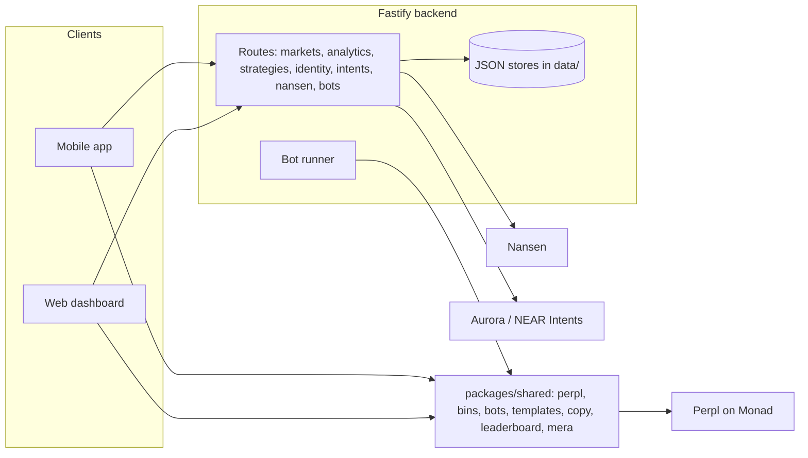

<div align="center">

# OpenCash

### Strategies you can see, trade and back — on Monad.

*A passkey-native trading terminal for Perpl perpetuals on Monad: themed bins, copyable strategies, smart-money signals and bots. Expo, Astro, Fastify, viem, MERA.*


[Web](https://monad.opencash.in)

</div>

## What is OpenCash?

Perps on Monad are fast and cheap, but trading them still means one market at a time, no view of who is actually good, and bots you have to trust blind. OpenCash turns Perpl's order book into **strategies**: a themed basket opened in one signature, a rule-based bot you can watch, a ranked strategy you can follow, and — next — a strategy vault you can back with capital.

The account is a passkey. No seed phrase, no extension: your face or fingerprint derives the wallet on every device, and the same passkey seals your private data.

Three ways in:
- **Mobile app** (Expo / React Native) — trade, bins, bots and account in your pocket
- **Web dashboard** (Astro) — the same terminal with depth: analytics, agent and strategy lab
- **HTTP API** (Fastify) — markets, analytics, strategies, identity, bots

> The differentiator: everything a strategy claims is checkable. Rankings come from Perpl's own on-chain events, follower results are measured after fees, and a bot's mandate is signed by its owner before it can trade.

## Features

### Bins — strategies as one trade
- **Themed baskets** — `majors`, `l1s`, `monad` and `quality-spread`, each a weighted set of Perpl markets with long and short legs
- **One-signature entry** — every leg sized against live depth and opened together; a two-leg bin was verified opening atomically on Perpl testnet
- **Weight modes and custom bins** — fixed weights or weights from live inputs, and your own basket from any market list

### Trade
- **Perpl perpetuals** — limit-first tickets with leverage, positions and history on Monad testnet
- **Swap in** — Aurora / NEAR Intents quotes that land funds at your passkey address on Monad (sending stays off until the first real order runs)
- **Builder code** — every order can carry OpenCash's Perpl builder code for revenue

### Copy, ranks and identity
- **Follow a strategy** — authors share a signed bot; followers follow with a signature and get an Auto bot
- **Honest ranking** — strategies rank by the median follower return after fees, author excluded, from the block each follower joined
- **Leaderboard** — per-account stats decoded from Perpl's on-chain events, refreshed every minute
- **Verified X** — link an address to an X handle with a signed tweet, no X API key

### Bots and the strategy lab
- **Card bots** — Guard closes at a stop or target; Auto opens when funding carry and checks pass, then guards
- **Strategy lab** — Donchian breakout, DCA, grid and trailing stop, tested on history and run on paper with fees and funding
- **Server runner** — bots that keep running with a trade-scoped Perpl key that cannot withdraw, under a mandate the owner signs
- **Nansen signal gate** — optionally require smart money to agree before a bot opens

### Analytics
- **Protocol, wallet and liquidation views** of Perpl, built from chain events because Perpl's public API has no wallet data
- **Nansen pulse and wallet intel** on bins and wallet profiles

### Account and safety
- **Passkey wallet (MERA)** — the passkey derives an EOA; a second salt seals profile and notes, so nothing personal lives on a server
- **Bring a wallet** — import a private key sealed by your passkey, kept only on the device
- **Recovery phrase** — 24 words for the passkey account, shown only after a fresh passkey check
- **Kill switch** — one flag 404s every route except the landing page and pauses the bot runner

## Where it is going

| Next | What it adds |
|---|---|
| Live lab strategies on Perpl | The lab's strategies trading real orders through the server runner, with server-watched stops, metrics and off switches |
| Copy first, vaults second | Followers already mirror a strategy into their own accounts. Next is a testnet prototype of a strategy vault: depositors get bin tokens, the manager trades only inside an on-chain mandate |
| Prize savings | Deposit AUSD, keep your principal, and the yield funds a weekly draw; trading and saving streaks earn extra tickets |

## Architecture



| Component | Role | Backed by |
|---|---|---|
| `packages/shared` | Perpl client and order specs, bins, bots, templates, copy ranking, leaderboard decoding, MERA accounts | viem, `@category-labs/mera` |
| `backend` | Market and analytics API, strategy ranking, X identity, intents, Nansen, server bot runner | Fastify, JSON files |
| `web` | Landing page and dashboard | Astro, Cloudflare Pages |
| `mobile` | Phone app | Expo, React Native |
| `contracts` | `OpenCashDelegate` (EIP-7702 delegate with passkey verification) | Foundry |

## API

| Route | Purpose |
|---|---|
| `GET /health` | Liveness and kill-switch state |
| `GET /market/tradable`, `/market/charts`, `GET /boards`, `/boards/:id` | Markets and themed boards |
| `GET /perpl/*` | Perpl data proxy |
| `GET /analytics/protocol`, `/wallet`, `/positions`, `/liquidations`, `/leaderboard` | Analytics |
| `GET /leaderboard`, `GET /portfolio/history` | Ranks and history |
| `GET/POST /strategies`, `POST /strategies/:id/follow`, `/unfollow` | Shared strategies and following |
| `GET /identity`, `POST /identity/challenge`, `/identity/verify` | X verification |
| `GET /intents/*`, `POST /intents/deposit-address` | Swap-in through Aurora / NEAR Intents |
| `GET /nansen/pulse`, `/nansen/wallet`, `/nansen/status` | Smart-money signals |
| `GET /bots`, `/bots/status`, `POST /bots`, `/bots/:id/:action`, `/bots/key`, `/bots/enroll/*` | Server bots and trade-key setup |

## Project structure

```
.
├── backend/            Fastify API and bot runner
├── packages/shared/    perpl, bins, bots, templates, copy, leaderboard, mera, nansen, intents
├── web/                Astro landing and dashboard, Cloudflare Pages functions
├── mobile/             Expo app
├── contracts/          OpenCashDelegate (Foundry)
└── docs/               integration notes and research
```

## Setup

1. `pnpm install`
2. Create `backend/.env` with the variables below
3. `pnpm backend` — API on `:8787`
4. `pnpm web` — dashboard, or `pnpm mobile` for the app

| Variable | Purpose |
|---|---|
| `PORT` | API port, default 8787 |
| `PERPL_API_URL`, `PERPL_BUILDER_ID`, `PERPL_BUILDER_FEE_PER_100K`, `PERPL_ENROLL_ORIGIN` | Perpl API, builder code, trade-key enrolment |
| `BOT_RUNNER`, `BOT_KEY_SECRET` | Server runner on/off and the key that encrypts stored trade keys |
| `NANSEN_API_KEY`, `NANSEN_CREDIT_CAP`, `NANSEN_PULSE_TTL_MIN` | Smart-money signals |
| `AURORA_INTENTS_KEY`, `ONECLICK_API_KEY`, `INTENTS_ALLOW_LIVE`, `INTENTS_FEE_BPS`, `INTENTS_FEE_RECIPIENT` | Swap-in |
| `LEADERBOARD_NETWORK`, `LEADERBOARD_WINDOW_HOURS`, `ANALYTICS_BACKFILL_DAYS` | Ranking and analytics windows |
| `KILL_SWITCH` | `1` turns the API off except `/health` (or create `backend/data/kill-switch`) |

## Security and trust

- Keys are derived on the device from your passkey; the backend never holds a key that can move funds.
- Server bots use a Perpl trade-scoped key that cannot withdraw, stored AES-256-GCM encrypted, under an owner-signed mandate.
- Imported wallets are sealed with the passkey and never leave the device.
- The passkey domain is `monad.opencash.in`, separate from the Hyperliquid app's, so the two products never share passkeys or wallets.

## Status

| Area | State |
|---|---|
| Typecheck (shared, backend, web, mobile) | Passes |
| Two-leg bin on Perpl testnet | Verified with real transactions |
| Bot orders, server runner, follower trades | Tested on fakes only; no testnet AUSD faucet located yet |
| X identity | Signed fixtures and negative cases only; no real tweet proof posted |
| Live lab strategies, strategy vaults, prize savings | In progress / planned |
| Landing | Live at monad.opencash.in; the dashboard is not deployed |

## License

No license file is committed at the repository root yet.

<div align="center">

Built on [Monad](https://monad.xyz) and [Perpl](https://perpl.xyz), with [viem](https://viem.sh), [Astro](https://astro.build), [Expo](https://expo.dev) and [Fastify](https://fastify.dev).

</div>
