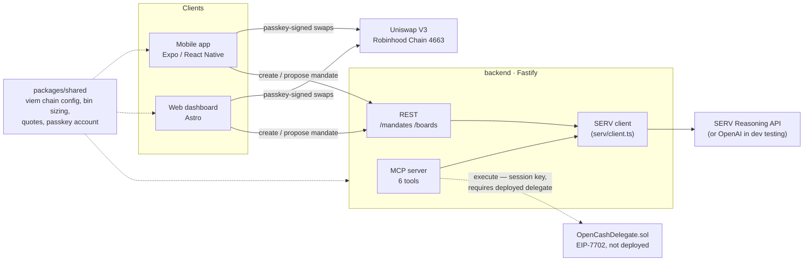

<div align="center">

# OpenCash

### Trade everything. Borrow nothing.

*A spot trading terminal for tokenized stocks on Robinhood Chain — Expo/React Native, Astro, Fastify, and viem, with passkey signing and EIP-7702 agent delegation.*


[Repository](https://github.com/Markets-Finance/Opencash)

</div>

## What is OpenCash?

Buying a tokenized stock onchain today usually means trading one symbol at a time with no thematic view, or handing funds to an opaque agent and hoping it does the right thing. OpenCash is a spot terminal for Robinhood Chain's Stock Tokens: pool several into a themed **bin** and enter with one signature, trade a single symbol directly, or write a plain-English **mandate** and let SERV Reasoning propose an allocation that still requires your own passkey to execute.

Three ways in:
- **Mobile app** (Expo / React Native) — the primary trading surface
- **Web dashboard** (Astro) — landing page, passkey sign-in, and the same five-tab experience in a browser
- **MCP server** — `create_mandate`, `propose_action`, `execute`, `start_watch`, `stop_watch`, `get_receipt`, for agent clients that speak MCP

> Nothing here is synthetic: every symbol is a real ERC-20 tracking its equity or ETF, every quote is a live call against a Uniswap V3 pool on Robinhood Chain, and every trade — manual or bot-proposed — is signed by your own passkey-derived key. The backend never holds a private key that can move your funds.

## Features

### Bins
- **Thematic baskets** — four built-in bins (mega-cap tech, AI compute, consumer platforms, a single-leg NVDA bin), each a weighted set of Stock Tokens
- **Live per-leg sizing** — every leg is quoted against its deepest Uniswap V3 pool right before you commit, not a cached price
- **One-signature entry** — an approval plus a batched `multicall` swap across every leg in a single passkey signature

### Trade
- **Search & filter** — by symbol or name, across ~195 Stock Tokens fed from Robinhood's own `/rhj` reference-price API
- **Buy & sell with live quotes** — execution price, expected output, and slippage tolerance shown before you sign
- **Held vs. all** — filter down to symbols you already hold through an open bin

### Bots (mandates)
- **Plain-English policy** — write a budget and a rule; no code
- **SERV-reasoned proposals** — `propose_action` asks SERV Reasoning (prompt-guard + shadow-agent validated) how much USDG to allocate right now, clamped against the mandate's remaining lifetime budget
- **Manual-approval execution** — every proposal still needs your tap; it signs with your own passkey key, the same code path as a manual bin purchase
- **Full receipt history** — every proposal and execution outcome, oldest first

### Account
- **Passkey-derived address** — no seed phrase; a WebAuthn PRF extension derives the signing key
- **Encrypted local profile** — name/email sealed with a key only your passkey can open, stored in `localStorage`
- **Portable identity card** — the same card component on mobile and web

### MCP tools

| Tool | Description |
|---|---|
| `create_mandate` | Persist a plain-English policy bounding how much USDG a SERV agent may allocate into a bin |
| `propose_action` | Ask SERV Reasoning how much to allocate right now, given the mandate and live pricing |
| `execute` | Sign a proposal's swaps with the agent's session key and submit on Robinhood Chain |
| `start_watch` | Re-run `propose_action` for a mandate on an interval |
| `stop_watch` | Stop a polling loop started by `start_watch` |
| `get_receipt` | Every proposal/execution outcome recorded for a mandate |

## Architecture



| Piece | Backed by |
|---|---|
| Trade execution (mobile/web) | viem + Uniswap V3 `SwapRouter02`, signed client-side by the user's passkey key |
| Bin/trade quotes | `QuoterV2`, live, per leg |
| SERV proposals | SERV Reasoning API, or OpenAI as a dev-only stand-in (see [Setup](#setup)) |
| Passkey → signing key | `@category-labs/mera`, WebAuthn PRF extension |
| Backend persistence | flat JSON files (`backend/src/store/jsonFile.ts`) — single-instance MVP storage |
| Agent delegation | `OpenCashDelegate.sol` (EIP-7702 + WebAuthn), written and tested, **not deployed** |

## Bin catalog

| Bin | Thesis | Legs |
|---|---|---|
| Mega cap tech | Four Stock Tokens, weighted toward the two with the deepest USDG pools | AAPL 30% · MSFT 30% · NVDA 25% · GOOGL 15% |
| AI compute | The chip and the two hyperscalers spending the most on it | NVDA 50% · MSFT 30% · GOOGL 20% |
| Consumer platforms | Three balance sheets that live on ad and subscription revenue | AMZN 50% · META 30% · AAPL 20% |
| NVDA | A single leg, for a straight view on one Stock Token | NVDA 100% |

## Robinhood Chain deployment

| | |
|---|---|
| Chain ID | `4663` (mainnet) |
| RPC | `https://rpc.mainnet.chain.robinhood.com` |
| USDG | `0x5fc5360D0400a0Fd4f2af552ADD042D716F1d168` |
| Uniswap V3 Factory | `0x1f7d7550B1b028f7571E69A784071F0205FD2EfA` |
| QuoterV2 | `0x33E885ED0EC9BF04ECfB19341582AAdCB4C8A9E7` |
| SwapRouter02 | `0xCaf681a66D020601342297493863E78c959E5cB2` |
| Testnet | `46630` — wallet/passkey mechanics only, no USDG, Stock Tokens, or Uniswap deployment |

## Project structure

```
.
├── mobile/              # Expo / React Native app — the primary trading surface
│   └── src/
│       ├── screens/     # Landing, Bins, Trade, BotHome, Account, ...
│       ├── components/  # PassCard, TabBar, Mark, ...
│       └── lib/         # hood.ts, backend.ts, agent.ts, mera.ts
├── web/                 # Astro landing page, passkey sign-in, dashboard
│   └── src/
│       ├── pages/       # index.astro, account.astro, dashboard.astro
│       ├── scripts/     # hood.ts, backend.ts, chain.ts, mera.ts (vanilla TS)
│       └── components/  # AccountCard.astro, Mark.astro
├── backend/             # Fastify API
│   └── src/
│       ├── agent/       # mandates, propose (SERV), execute, receipts, watch
│       ├── boards/      # saved groups of bins
│       ├── mcp/         # MCP server + 6 tools
│       └── serv/        # SERV Reasoning / OpenAI client
├── packages/shared/     # chain config, bin sizing/quotes, passkey account — used by all three
│   └── src/
│       ├── hood/        # Robinhood Chain: addresses, ABIs, quoting, registry
│       ├── bins/        # bin catalog, sizing, execution
│       ├── mera/         # passkey account derivation
│       └── perpl/       # legacy Monad-perp code, unused by the hood build
├── contracts/           # Foundry — OpenCashDelegate.sol (EIP-7702 + WebAuthn), not deployed
└── docs/                # research and decision notes
```

## Setup

```sh
pnpm install

# backend — create backend/.env first (see table below)
pnpm backend      # http://localhost:8787

# web
pnpm web          # http://localhost:4321

# mobile
pnpm mobile       # Expo dev server
pnpm android      # Expo dev server, --dev-client
```

```sh
cd contracts && forge build && forge test
```

| Env var | Required | What |
|---|---|---|
| `PORT` | no (default `8787`) | backend HTTP port |
| `SERV_API_KEY` | for real SERV Reasoning calls | SERV Reasoning API key |
| `SERV_MODEL` | no | overrides the default SERV model |
| `SERV_MULTIPATH` | no | `"true"` appends `-serv-multipath` to the model id |
| `SERV_REASONING_EFFORT` | no (default `"low"`) | SERV `reasoning_effort`; `"off"` omits the field |
| `OPENAI_API_KEY` | dev-only testing switch | when set, `propose_action` calls OpenAI instead of SERV — same tool-calling shape, without SERV's shadow-agent validation |
| `OPENAI_MODEL` | no (default `gpt-4o-mini`) | overrides the default OpenAI model |
| `AGENT_SESSION_KEY` | for the MCP `execute` tool | private key the backend signs session-key swaps with, once a user authorizes it on their own deployed `OpenCashDelegate` |

## Security & trust

- **Your funds never touch a backend-held key.** Every manual trade and every mandate execution from the mobile or web app is signed client-side by your passkey-derived key.
- **Mandates are manual-approval by design.** `propose_action` returns a number and a reason; nothing moves until you tap execute.
- **`AGENT_SESSION_KEY` currently can't move anyone's funds.** It's the signer for the MCP `execute` tool's session-key path, scoped by `OpenCashDelegate` to specific contract calls — but that contract isn't deployed to mainnet, so the path is inert today.
- **No P-256 precompile on Robinhood Chain.** `OpenCashDelegate`'s WebAuthn verification falls back to a pure-Solidity implementation rather than assuming RIP-7212 is live.

## Status

| Claim | Status |
|---|---|
| Robinhood Chain mainnet addresses (USDG, Factory, QuoterV2, SwapRouter02) | Verified live on-chain |
| Stock Token buy/sell via `SwapRouter02` | Verified live, mobile + web |
| Bin entry via `multicall` | Verified live |
| Passkey sign-in & key derivation | Working, mobile + web |
| Backend REST (`/mandates`, `/boards`) | Working against a local dev server |
| SERV Reasoning proposals | Working; currently routed to OpenAI in dev (SERV account balance is near zero) |
| MCP `execute` / session-key auto-execution | Written, **not usable** — `OpenCashDelegate` isn't deployed |
| RIP-7212 (P-256 precompile) on Robinhood Chain | Confirmed **not live** |
| Backend persistence | Flat JSON files — single-instance only, not production storage |
| Waitlist (`web/functions/waitlist.ts` + D1 migration) | Present in the repo, not exercised this cycle |
| Web dashboard passkey flow, end-to-end in a real browser | Not verified this cycle — needs a WebAuthn authenticator |

## License

No LICENSE file is committed at the repo root. (`mobile/LICENSE` is Expo's own template license for the app scaffolding, not a license for this project.)

---

<div align="center">

Built with [Astro](https://astro.build), [Expo](https://expo.dev) & [React Native](https://reactnative.dev), [Fastify](https://fastify.dev), [viem](https://viem.sh), [Uniswap V3](https://uniswap.org), and SERV Reasoning.

</div>
