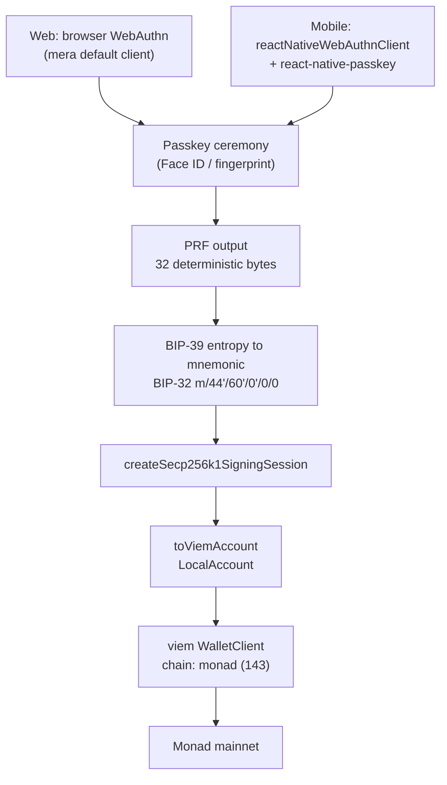

# MERA integration

How passkey accounts are wired into this repo, and why MERA was chosen over the alternatives.

Verified against `@category-labs/mera@0.2.0` (published 2026-08-12) by reading the installed
type definitions in `node_modules/@category-labs/mera/dist`, not from documentation summaries.

---

## What MERA is

MERA is a client-side TypeScript library from **Category Labs** — the company that builds Monad —
that derives ordinary blockchain accounts from a passkey. Tagline: *"Accounts on any chain and
platform, from a passkey."*

It works through the **WebAuthn PRF extension**. Alongside the normal assertion signature, a passkey
can evaluate a pseudorandom function and return 32 deterministic bytes. Those bytes are a
function of `(credential, rpId, salt)` — the same passkey, on the same domain, with the same salt,
returns the same 32 bytes on every device the passkey syncs to. MERA's default salt is
`sha256("mera.prf.salt.v1")` and is documented as stable across library versions.

Those 32 bytes are used as BIP-39 entropy, run through BIP-32 to `m/44'/60'/0'/0/0`, and become a
secp256k1 private key. **Nothing is stored.** The account is recreated from the passkey each time.

| Property | Value |
|---|---|
| Package | `@category-labs/mera` |
| Version used | `0.2.0` (preview — API may change before 1.0) |
| License | MIT **OR** Apache-2.0, at our option |
| Runtime deps | `@noble/curves`, `@noble/hashes`, `@scure/base` only |
| Peer deps | `viem ^2.28.0`, `react-native-passkey 3.6.1` |
| Platforms | Browsers, Chrome extensions, React Native (iOS 18+, Android 9+) |
| Cost | Free, open source |

---

## Why we use it

### 1. Our margin design needs an EOA, not a smart account

The trading architecture keeps positions **non-custodial**: the user's own address owns the
lending-market position through a sub-account, and our router is registered as an operator that
batches calls on their behalf. That model breaks if a contract wallet sits between the user and the
vault — the vault would see the wallet as the owner, not the user.

MERA derives a **plain secp256k1 EOA**. `toViemAccount(session)` returns a `LocalAccount<"mera">`
that viem treats like any private-key account. An ERC-4337 embedded-wallet provider would have given
us a contract account and changed the ownership model. This is the decisive reason.

### 2. One passkey produces the same address on web and mobile

We committed to shipping both an Astro web app and an Expo mobile app. PRF output is deterministic
on `(credential, rpId, salt)`, and passkeys sync through iCloud Keychain and Google Password
Manager. So the **same passkey yields the same address on both surfaces with no account-linking
backend, no email login, and no key export**.

This is what makes shipping two clients cheap rather than twice the work. It only holds if both
surfaces use the **same `rpId`** — see the constraint section below.

### 3. Signing sessions match how trading actually works

Opening a leveraged position is several signatures in a row — approve, supply, borrow, swap. A
biometric prompt per signature would turn a one-tap trade into a five-prompt trade.

A MERA signing session holds the derived key **in memory** and signs without contacting the
authenticator. From `viem.d.ts`: *"signing never shows a passkey prompt."* One Face ID at the start
of a trading burst, silent signatures after it, and `session.end()` zeroes the key copy when done.

### 4. No backend, no custody, no MPC

There is no point building a non-custodial margin router and then custodying keys to reach it.
MERA needs no server, no key-management service, and no smart contract. We hold nothing.

### 5. EIP-7702 comes with it

`toViemAccount` implements `signAuthorization`. Monad's EVM is **Fusaka-equivalent and supports
EIP-7702** (confirmed in Monad's developer docs, which also list the P-256 precompile at `0x0100`
per EIP-7951, 300 ms blocks and 600 ms finality). So the passkey EOA can delegate to a batching
implementation and make open/close a single atomic transaction — without giving up the EOA model
that reason 1 requires.

### 6. It is Monad's own library

Category Labs builds both Monad and MERA. Metropolis carries MERA passkey bounties, so the
integration is aligned with the hackathon's sponsor track rather than bolted on for it.

---

## How the integration is built



The derivation is written **once** in `packages/shared` and is platform-agnostic. Each client
injects its own `WebAuthnClient` and its own credential storage. Nothing about the account differs
between web and mobile.

### Files

| File | Role |
|---|---|
| `packages/shared/src/mera/account.ts` | Derivation, `createTradingAccount`, `signInTradingAccount` |
| `packages/shared/src/mera/config.ts` | `relyingPartyId` / `relyingPartyName` — one source of truth |
| `packages/shared/src/mera/namespace.ts` | Fixed-salt PRF namespaces: HKDF + AES-256-GCM, pure JS |
| `packages/shared/src/mera/journal.ts` | Namespace sessions (`terminal.journal.v1`, `terminal.alerts.v1`) |
| `packages/shared/src/mera/index.ts` | Public surface of the mera module |
| `packages/shared/src/viem-chain.ts` | `monad` / `monadTestnetChain` viem chain definitions |
| `packages/shared/src/index.ts` | Re-exports for both clients |
| `web/src/scripts/mera.ts` | Browser wiring — `localStorage`, `rpId = location.hostname` |
| `android/src/lib/mera.ts` | React Native wiring — AsyncStorage, RN WebAuthn client, RNG polyfill |
| `android/app.json` | iOS `associatedDomains`, bundle identifier, Android package |

### The shared core

`deriveTradingAccount` is the whole mechanism:

```ts
const seed = mnemonicToSeedSync(entropyToMnemonic(prfOutput, wordlist));
const node = HDKey.fromMasterSeed(seed).derive("m/44'/60'/0'/0/0");
const session = createSecp256k1SigningSession({ privateKey: node.privateKey });
return {
  address: getEvmAddress(session.publicKey),
  account: toViemAccount(session),
  end: () => session.end(),
};
```

Two entry points sit on top of it:

- **`createTradingAccount`** — runs `createPasskeyWithPrfOutput`, persists the returned
  `credentialId` and `transports`, derives the account. One ceremony, one prompt (two on
  authenticators that cannot evaluate PRF at creation time).
- **`signInTradingAccount`** — reads the stored credential metadata, runs `getPasskeyPrfOutput`
  restricted to it, re-derives the identical account. Rewrites storage if the platform picked a
  different credential.

Credential metadata is **not a secret** — it is a credential ID, useless without the authenticator.
Storing it only narrows the WebAuthn prompt to the right passkey.

### Platform differences

|  | Web | Mobile |
|---|---|---|
| WebAuthn client | MERA's built-in browser client (default) | `reactNativeWebAuthnClient` from the `/react-native-webauthn-client` export |
| Underlying API | `navigator.credentials` | `react-native-passkey@3.6.1` |
| Credential storage | `localStorage` | `@react-native-async-storage/async-storage` |
| `rpId` source | `relyingPartyId`, or `localhost` in dev | `relyingPartyId` |
| RNG | native `crypto.getRandomValues` | `react-native-get-random-values` polyfill, imported first |

---

## PRF namespaces (non-wallet key material)

The PRF is a function, not a single secret: a different 32-byte salt yields unrelated output from
the same passkey. MERA's default salt is `sha256("mera.prf.salt.v1")` and backs the wallet key.
`namespaceSalt(name)` computes `sha256(name)` for any other namespace, so:

| Namespace | Salt | Used for |
|---|---|---|
| MERA default | `sha256("mera.prf.salt.v1")` | The EOA signing key |
| `terminal.journal.v1` | `sha256("terminal.journal.v1")` | Encrypting trade notes |
| `terminal.alerts.v1` | `sha256("terminal.alerts.v1")` | Encrypting alert rules |

Each PRF output is run through HKDF-SHA256 (info `terminal.v1.encrypt.<namespace>`) to a 256-bit
AES-GCM key, with a fresh random 12-byte nonce per record. A `SealedRecord` is plain JSON and
carries no secret, so it can be stored anywhere readable by anyone.

**Fixed salt, not random.** MERA's secret vaults generate a *random* salt and store it in the vault,
which is correct for wrapping a pre-existing secret but means the vault must survive. Namespaces use
a *fixed* salt derived from the namespace name, so the key is reconstructible from the passkey
alone — a fresh browser profile with no local state can decrypt. Using the vault API here would
compile and quietly fail that test.

Each namespace costs one extra assertion ceremony, because MERA evaluates one salt per call. The
wallet and the journal are therefore two separate prompts.

---

## Constraints that bind us

**`rpId` is permanent.** Passkeys are bound to the domain they were created under. If the web app
moves domains, every derived account becomes unreachable and every vault undecryptable. The domain
must be chosen once, before any real user creates a passkey. `packages/shared/src/mera/config.ts` and
`android/app.json` currently carry the placeholder **`terminal.example.xyz`** — both must be
replaced with the real domain before anything ships.

**Both surfaces must share one `rpId`.** The same-address-everywhere property depends on it, so the
value is single-sourced as `relyingPartyId` in `packages/shared/src/mera/config.ts` and imported by
both clients. Deriving it from `location.hostname` on web would silently diverge from mobile the
moment the site sits on a subdomain — different `rpId`, different credential, different address, no
error. Web falls back to `localhost` only in local development, which produces a separate throwaway
account by design.

Sharing the `rpId` also requires **proving domain ownership from each app**: `/.well-known/assetlinks.json`
listing the Android package and signing-certificate fingerprint, and the Apple App Site Association
file for the iOS entitlement. Until both are hosted on that domain, mobile passkeys will not resolve.

**MERA's own secret-vault API is web-only.** `createSecretVaultWithNewPasskey` and friends need
`crypto.subtle` for AES-256-GCM, which React Native does not provide. That limits the *imported
private key* flow to web unless a WebCrypto polyfill is added.

It does **not** limit our own encrypted namespaces. `packages/shared/src/mera/namespace.ts` uses
`@noble/ciphers` and `@noble/hashes` — pure TypeScript, the same audited family MERA itself depends
on — so HKDF and AES-256-GCM run identically on web and React Native with no native module and no
polyfill. Only `crypto.getRandomValues` is needed, which the RN polyfill already supplies.

**Expo Go will not work.** `react-native-passkey` is a native module, so mobile needs a development
build (`expo prebuild`). iOS 18+ and Android 9+ are hard floors.

**Never gate the UI on local storage.** Credential metadata in `localStorage` is a prompt-narrowing
hint, nothing more — absent it, WebAuthn falls back to discoverable-credential selection and derives
the identical address. A fresh browser with a synced passkey therefore *has* an account while having
no stored credential. Any "do they have an account?" check built on local storage will route a
returning user into creating a second passkey, which derives a **different address** and looks like
an emptied wallet. **Sign in is always the primary action; account creation is a deliberate
secondary choice.** A `hasStoredCredential()` helper existed briefly and was removed for this reason.

**Device loss means account loss** unless the passkey is synced or backed up. MERA's own security
model states this plainly. Any real launch needs a recovery story — the secret-vault export path is
the library's answer, and it is web-only today.

**Same-origin script execution can capture PRF output.** MERA's threat model is explicit: an
injected script or a malicious dependency on our own domain can replace the browser APIs MERA calls
and keep the PRF bytes. Dependency discipline is a security control here, not hygiene.

**0.2.0 is preview software.** Category Labs completed an internal security review; the API may
change before 1.0. Only two versions have ever been published (0.1.0, 0.2.0). Pin the version.

---

## Status

| Item | State |
|---|---|
| Shared derivation module | Written, `tsc --noEmit` clean |
| Web wiring | Written, typechecks clean |
| Mobile wiring | Written, typechecks clean |
| Monad chain definitions for viem | Written, chain ID 143 verified live (block 106,539,186) |
| EIP-7702 support on Monad | Confirmed in Monad developer docs |
| PRF namespaces (encrypt / decrypt) | Written, round-trip verified at runtime |
| Namespace isolation, tamper + wrong-key rejection | Verified at runtime |
| Remote store for sealed records | **Not built** — server vs on-chain undecided |
| Passkey ceremony on a real browser | **Not run** |
| Passkey ceremony on a real device | **Not run** — needs a dev build and a real `rpId` |
| Same address across web and mobile | **Not demonstrated** — depends on the two items above |
| assetlinks.json / AASA hosting | **Not done** — no domain chosen yet |

Nothing in the "not run" rows should be described as working until it has been.
